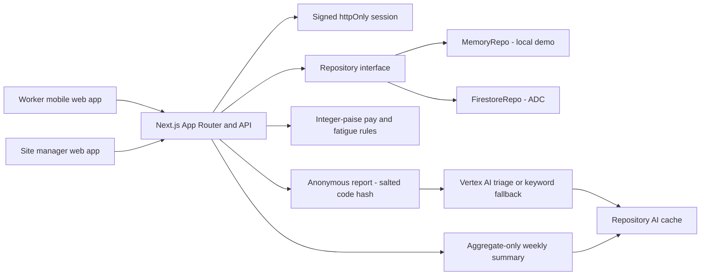

# FairShift

FairShift makes work safer and fairer for employee-intensive organisations. It links attendance records to understandable payroll, lets workers raise anonymous concerns and track the follow-up, and gives administrators aggregated early-warning signals.

## What it does

- **Worker app:** mobile-first home, check-in/out, weekly hours and fatigue warnings, monthly explained payslip, anonymous reporting and tracking, skill passport, and anonymous feedback.
- **Explain My Pay:** itemised explanations in English, Tamil, and Hindi, browser text-to-speech, and expandable links to the attendance records behind each amount. Incomplete time records are excluded and explicitly flagged for review.
- **Safe attendance:** check in with a workplace QR signed for one organisation and expiring in 60 seconds, or use the no-camera fallback. Shifts can be selected from the active industry profile.
- **Anonymous reporting:** the report record has no worker ID or name. Workers receive a random tracking code; only a salted SHA-256 hash is stored. Admins see a short hash prefix, report text/triage, and public replies, never reporter identity.
- **Admin tools:** attendance and grievance dashboard, 14-day charts, fatigue indicators, transparent retention signals, anonymous report review, worker roster and attendance history, skills verification, rotating QR, payroll preview/rule editing/CSV export, and protected anonymous-feedback aggregates.
- **Two industry profiles:** Construction Site and College use different roles, shift names, pay rules, report categories, skills, and translated category labels.
- **AI assistance:** Vertex AI Gemini can classify and summarize reports and prepare a short weekly summary. Local development and cloud/model failures use deterministic rules; AI is never required to run the app.
- **Installable shell:** the web manifest and service worker cache the public app shell and static assets. Authenticated API responses are never cached.

## Industry profiles

FairShift supports two kinds of work from one typed industry profile, rather than maintaining separate products. **Construction Site** covers Masons, Electricians, Helpers, and Supervisors on Day or Night shifts. It uses daily-wage hourly calculations with overtime at 1.5× after eight hours, plus PF and ESI deductions; its reporting categories and skills focus on site safety and trade work. **College** covers Housekeeping, Security, Lab Assistants, and Guest Lecturers on Morning or Evening shifts. It supports monthly-salary and hourly staff, overtime at 1.25× (or 1.5× for hourly staff), PF, and campus-specific reporting categories and skills. The demo industry control swaps the active organisation without changing application code.

## Architecture



## Local setup

Use the existing Next.js project in this directory (the separate Vite starter at the workspace root is not part of this app).

```bash
npm ci
npm run dev
```

Open `http://localhost:3000`. Without `GOOGLE_CLOUD_PROJECT`, the app uses a seeded, process-local `MemoryRepo`; no Google Cloud credentials are needed. Demo worker PIN: `1234`. Demo admin PIN: `2468`. The two demo organisations are **Chennai BuildWorks** (Construction Site) and **South City College**.

For the in-app industry switcher and one-click demo accounts, create `.env.local` from `.env.example` and set `NEXT_PUBLIC_DEMO=true`. Replace the local example session and tracking salts if the app is exposed beyond a trusted development machine. The quick-login control intentionally bypasses PIN verification and must remain disabled in production.

Optional environment variables:

| Variable | Purpose |
| --- | --- |
| `SESSION_SECRET` | At least 32 characters; signs sessions and QR tokens. Required in production. |
| `TRACKING_SALT` | Salt used to hash report tracking codes; defaults to `SESSION_SECRET`. |
| `USE_MEMORY_DB=true` | Force the local in-memory repository, even if a project ID is present. |
| `GOOGLE_CLOUD_PROJECT` | Enables Firestore unless MemoryRepo is forced. |
| `GOOGLE_CLOUD_LOCATION` | Vertex AI region, for example `asia-south1`. |
| `GEMINI_MODEL` | Vertex model; defaults to `gemini-2.5-flash`. |
| `NEXT_PUBLIC_DEMO=true` | Shows demo controls; use only for local demos. |

MemoryRepo data lives only in the running Node process and resets when it restarts. Firestore is durable and uses Application Default Credentials. Do not put credential key files in this repository. A Firestore deployment must be provisioned with the required organisation/worker documents and production PIN hashes before staff can sign in; the local demo seed is not automatically copied to cloud.

## Tests and build

```bash
npm run lint
npm test
npm run test:e2e
npm run build
npm start
```

Vitest covers pay arithmetic and edge cases, fatigue detection, tracking-code hashing, seed shape, signed sessions, rate limits, and multilingual triage fallback. The Playwright smoke test exercises worker check-in, English/Tamil/Hindi explained pay, anonymous report submission and tracking, admin review, and switching to the College profile. The smoke test starts its own local MemoryRepo-backed Next.js server.

## How AI is used

Triage is server-only. When project and location are configured, Gemini receives the anonymous report text as untrusted input plus the selected industry's allowed categories. A strict system instruction confines the model to classification and translation; response JSON is validated with Zod and a five-second timeout. Failed, timed-out, empty, or invalid model responses use the local English/Tamil/Hindi keyword classifier. Results are cached by a one-way digest of industry, category, and text.

The weekly summary uses only aggregated counts (report categories and urgency, check-ins, and overtime). It does not send worker names, IDs, report tracking codes, or report text to the model. If Vertex AI is not configured or unavailable, a concise rules-based summary is returned and marked as `rules`.

## Security and privacy

- Server-signed HS256 sessions are stored in `httpOnly`, `SameSite=Lax` cookies; production requires `SESSION_SECRET`. Protected route middleware/proxy checks role, while handlers check the role and scope again.
- Worker APIs derive the worker ID and organisation from the signed session, not request parameters. Admin endpoints scope every read and write to the session organisation.
- Grievance documents contain no worker ID/name. The raw tracking code is shown once to the worker; only its salted hash is stored. Admin views expose only a short hash prefix.
- Feedback records contain ratings, optional comment and organisation but no worker identity. Admin rating breakdowns are withheld until at least five responses exist; individual entries are never returned.
- Rate limits apply to login, report submission, feedback and code lookup. Input is validated with Zod. Image uploads are compressed in the browser to below 300 KB before submission.
- Security response headers include a restrictive CSP, `X-Content-Type-Options`, referrer protection, frame protection, and camera/microphone permissions scoped to the same origin. The production CSP permits inline scripts required by the current Next.js renderer; review it if the rendering strategy changes.
- Keep demo mode off on the internet. The demo quick-login intentionally skips PIN checks. Demo PINs are for local testing only.

## Accessibility

The layouts support narrow screens (including 360 px), keyboard focus indicators, skip links, labels, live status messages, reduced motion, large touch targets, and text alternatives. Voice reporting and speech playback are feature-detected and fall back to typed text or visible explanations when unsupported. Tamil/Hindi selection updates the document language and persists in a cookie.

## Cloud Run deployment

Cloud deployment is documented but has not been run or verified from this workspace. Configure a Google Cloud project, billing, and permissions before following these steps. The Cloud Run service uses ADC through its service account; never deploy a service-account key.

```bash
export PROJECT_ID="your-project-id"
export REGION="asia-south1"
export SERVICE_ACCOUNT="fairshift-runtime@${PROJECT_ID}.iam.gserviceaccount.com"
gcloud config set project "$PROJECT_ID"

gcloud services enable run.googleapis.com firestore.googleapis.com aiplatform.googleapis.com secretmanager.googleapis.com cloudbuild.googleapis.com
gcloud iam service-accounts create fairshift-runtime --display-name="FairShift Cloud Run runtime"
gcloud firestore databases create --location="$REGION" --type=firestore-native

gcloud projects add-iam-policy-binding "$PROJECT_ID" --member="serviceAccount:${SERVICE_ACCOUNT}" --role="roles/datastore.user"
gcloud projects add-iam-policy-binding "$PROJECT_ID" --member="serviceAccount:${SERVICE_ACCOUNT}" --role="roles/aiplatform.user"
gcloud projects add-iam-policy-binding "$PROJECT_ID" --member="serviceAccount:${SERVICE_ACCOUNT}" --role="roles/secretmanager.secretAccessor"

openssl rand -base64 32 | gcloud secrets create SESSION_SECRET --data-file=-
gcloud run deploy fairshift --source . --project "$PROJECT_ID" --region asia-south1 --service-account "$SERVICE_ACCOUNT" --allow-unauthenticated --port 8080 --set-env-vars "GOOGLE_CLOUD_PROJECT=${PROJECT_ID},GOOGLE_CLOUD_LOCATION=asia-south1,USE_MEMORY_DB=false,NEXT_PUBLIC_DEMO=false" --set-secrets "SESSION_SECRET=SESSION_SECRET:latest"
```

For secret rotation, add a new secret version with `openssl rand -base64 32 | gcloud secrets versions add SESSION_SECRET --data-file=-` and redeploy/restart the service. Provision Firestore organisation and worker documents with securely generated bcrypt PIN hashes before enabling sign-in. `deploy.sh` runs the same Cloud Run source deployment command after `PROJECT_ID` is set. Docker builds use the multi-stage, non-root Node 20 image and listen on port 8080.

## Assumptions and limitations

- Demo attendance uses UTC timestamps and an India workplace date. Day/night and morning/evening shifts are explicit profile selections; the prototype does not enforce a manager-defined roster or location/geofence.
- A missing or malformed checkout is treated as zero payable hours and flagged for review; the app never guesses a checkout time.
- Retention signals are explanatory indicators, not automated employment decisions. Anonymous unresolved reports are shown only as organisation-wide context and are never assigned to a named worker.
- MemoryRepo and its in-memory rate limiter are single-process demo implementations; use Firestore and a shared rate-limit service for horizontally scaled production.
- Browser speech recognition, camera access, and install prompts depend on device/browser support and permissions. Manual check-in, typing, and text explanations remain available.
- Cloud credentials, Vertex AI availability, Firestore provisioning, Cloud Run deployment, and Docker availability depend on the target environment and are not assumed to have succeeded.
